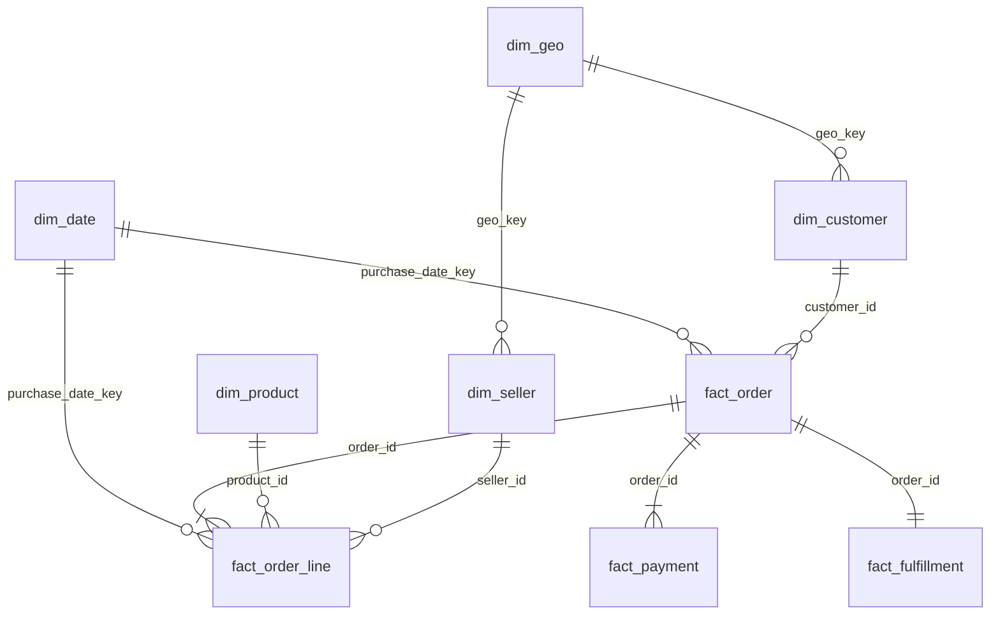

# 数仓设计：概念、逻辑与物理（DW-01）

- 版本：v1.1，2026-11-10，claude-opus-5-5 起草并自审（v1.1 在 DW-04 中增加 `dws.orders_daily_region`）
- 依据：契约 `synthetic-transaction-v1`、交易规则 `transaction-rules-v1`、`docs/architecture.md`（GOV-06）
- 物理 DDL：`sql/ddl.sql`，由 `evidence/DW-01/gen_ddl.py` 从契约生成（ODS 列名和 DWD 列类型直接取自契约），不要手改。
- 引擎：DuckDB 单文件。离线构建写一个新文件，校验后发布为只读快照（DW-07、DW-10）。
- `docs/architecture.md` §3 中“路线 A（UCI）”一列已随 D013 作废，以本文为准。

## 1. 分层职责

| 层 | schema | 职责 | 不做什么 |
|---|---|---|---|
| ODS | `ods` | 按源表原样保存每个值（全部为文本），附批次号、源文件路径、源文件哈希、行号和加载时间；任何一行都能定位到源文件的那一行 | 不改值、不转类型、不去重 |
| DWD | `dwd` | 星型模型：按契约转类型、改为标准列名；订单级金额从明细汇总；维度去重；记录事件时间但不在表里固化“是否有效” | 不放生成器标签；不做跨时点汇总 |
| DWS | `dws` | 按日、客户、商品的汇总；客户×as_of 时点快照；单独的标签表 | 不把不可加指标（去重客户数、去重订单数）设计成可以相加 |
| ADS | `ads`（视图） | 指标语义视图：经营总览、cohort、分群、风险；AI 只能查 `meta.allowed_view` 中登记的视图 | 不复制数据，不写入 |
| 元数据 | `meta` | 加载批次与文件登记、允许视图清单 | — |

## 2. 概念模型与粒度

| 表 | 类型 | 一行代表 | 主键 | 主要来源 |
|---|---|---|---|---|
| `dwd.fact_order_line` | 事实 | 一条订单明细 | `order_id` + `order_item_seq` | `ods.order_items` |
| `dwd.fact_order` | 事实 | 一张订单 | `order_id` | `ods.orders`，汇总明细与支付，并入评价和延迟标记 |
| `dwd.fact_payment` | 事实 | 一次支付 | `order_id` + `payment_seq` | `ods.payments` |
| `dwd.fact_fulfillment` | 事实 | 一张订单的物流 | `order_id` | `ods.shipping` |
| `dwd.dim_date` | 维度 | 一个日历日 | `date_key`（yyyymmdd） | `ods.calendar` |
| `dwd.dim_geo` | 维度 | 一个城市 | `geo_key` = 大区|州|城市 | 客户与卖家的地址字段 |
| `dwd.dim_customer` | 维度 | 一个客户 | `customer_id` | `ods.customers` |
| `dwd.dim_product` | 维度 | 一个商品 | `product_id` | `ods.products` |
| `dwd.dim_seller` | 维度 | 一个卖家 | `seller_id` | `ods.sellers` |
| `dws.sales_daily_category_region` | 汇总 | 日期×品类×客户大区 | 三者组合 | 明细 + 商品 + 客户 |
| `dws.orders_daily_region` | 汇总 | 日期×客户大区 | 两者组合 | 订单 |
| `dws.customer_daily` | 汇总 | 客户×日期 | 两者组合 | 订单 |
| `dws.product_daily` | 汇总 | 商品×日期 | 两者组合 | 明细 |
| `dws.customer_snapshot` | 快照 | 客户×as_of | 两者组合 | 订单（只用 as_of 前已审批的） |
| `dws.label_repurchase` | 标签 | 客户×as_of×窗口×标签版本 | 四者组合 | 订单（as_of 之后的窗口） |



- 订单明细是最细的事实粒度。`fact_order_line` 冗余保存 `customer_id` 和 `purchase_date_key`，方便按客户、日期切片时不必先连订单表，但不会改变粒度。
- 支付是一对多（一单最多两次），只在 `fact_payment` 中保留；订单级只保存汇总后的金额和行数，避免连接后金额翻倍（DATA-09 实测直接连接会多出 1,212 行）。
- 评价每单至多一条，直接并入 `fact_order`。

## 3. 层级只画源数据支持的部分

| 维度 | 层级 | 依据 |
|---|---|---|
| 日期 | 年 → 季度 → 月 → 周 → 日 | `calendar` 表 |
| 地理 | 大区 → 州 → 城市 | 客户与卖家都有 region、state、city 三个字段；实测城市都落在所属州内（DW-03 校验） |
| 商品 | 品类 → 商品 | 只有一级品类（16 类），**没有子品类**，不虚构上下级 |
| 卖家 | 卖家（经地理维度上卷） | 卖家分群是生成器参数，不作层级 |

没有渠道、门店、品牌、组织层级，不建这些维度。

## 4. 动态属性与静态属性分开

- `dim_customer` 只放静态属性：地址、合成建档日期。
- 生成器给出的 `customer_segment`、`customer_lifecycle_stage` 不进入数仓维度。它们是期末值，会泄漏未来信息，也不是项目自己的规则。
- 项目计算的生命周期状态（EDA-05）、RFM 分群（ML-05）、风险分（ML-11）都带 `as_of` 和版本，分别存在 `dws.customer_snapshot` 或模型输出表中，**永远不回写维度表**。同一客户在不同 as_of 可以有不同状态。

## 5. 时间语义在数仓中的落地

- 订单是否为“有效购买”取决于观察时点：`approved_ts < as_of`。DWD 只记录事件时间，不固化成一个是否有效的字段；ADS 视图默认以数据截止 2026-11-08T00:00:00Z 作为 as_of。
- 最终 `order_status` 保留在 `fact_order` 中供对账和展示，模型和快照不使用它。
- 延迟两种口径并存：`late_by_date`（默认）和 `late_by_days`（生成器口径）。

## 6. 血缘（每张表从哪里来）

```
ZIP 成员 CSV ──DATA-05 ingest──▶ engineering history_source/*.csv
   └─DW-02──▶ ods.<表>（文本 + _batch_id/_row_no）+ meta.load_batch/load_file
        └─DW-03──▶ dwd.dim_* / dwd.fact_*（按契约转类型；订单金额 = 明细汇总）
              ├─DW-04──▶ dws.orders_daily_region / sales_daily_category_region / customer_daily / product_daily
              ├─DW-05──▶ dws.customer_snapshot、dws.label_repurchase
              └─DW-06──▶ ads.* 视图 + meta.allowed_view
```

- 对照：DATA-07 的 Python 清洗结果（`data/processed/clean/…-clean-v2`）与 DWD 是两套独立实现，DW-09 逐表核对行数和金额一致。

## 7. 刷新顺序

1. `sql/ddl.sql` 建库（新文件）。
2. ODS：登记批次（状态 `loading`）→ 逐文件加载并核对行数与清单 → 批次状态改为 `loaded`。同一批次已是 `loaded` 时跳过。
3. DWD：先维度（日期 → 地理 → 客户、商品、卖家），后事实（订单 → 明细 → 支付 → 物流）。
4. DWS：日汇总 → 客户快照与标签。
5. ADS 视图与允许视图清单。
6. 约束与对账检查（DW-09）通过后，整体发布为只读快照（DW-10）；任何一步失败都不发布。

## 8. 与契约的一致性

- ODS 列名与契约原始列名一一对应（由生成器保证）。
- DWD 中来自源表的列使用契约标准名和类型；以下是派生列，不在契约里：`purchase_date_key`、`geo_key`、`merch_usd`、`shipping_usd`、`order_value_usd`、`item_lines`、`payment_value_usd`（订单级汇总）、`payment_rows`、`late_by_date`、`late_by_days`、`delivery_days_floor`，以及 dim_date 的 `date_key`、`calendar_date`，dim_geo 的 `region`、`state`、`city`（来自客户与卖家地址字段的去重组合）。
- DW-01 的核对脚本执行 DDL，并检查以上两点。
